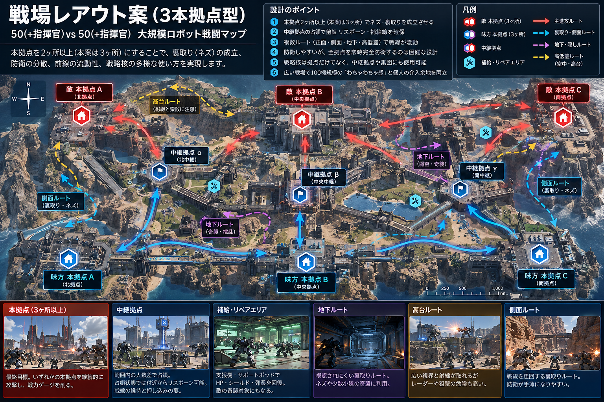
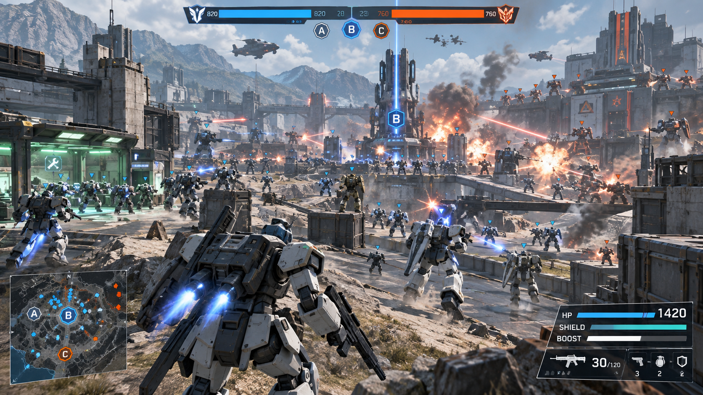

# ゲームビジョン・ベースイメージ（v0.2）

## 1. 一文で表すゲーム
**100機のうちの1機として気楽に混戦へ飛び込み、何もせずとも動く戦場で、時には自分ひとりの凸・ネズミ・核・防衛によって戦況を覆せるロボット戦闘ゲーム。**

## 2. 感情・体験の柱
1. **わちゃわちゃ感**：大量の味方と敵が集まり、射撃・格闘・爆発・再出撃が止まらない。
2. **責任のなさ**：前線で撃つだけでも、支援するだけでも、裏取りしてもよい。個人に勝利義務を負わせない。
3. **一撃の影響力**：不十分な防衛を突くネズミ、集団凸、戦略核、敵の高コストデッキへの損害が大きく効く。
4. **分かる戦況**：中継拠点、レーダー、味方の凸ピン、ゲージによって「今何が起こっているか」を把握できる。
5. **公平に弱いAI**：BOTは索敵情報・認識遅れ・CT・弾薬・補給制約に従う。AIのみの完全情報・反射神経チートは禁止。

## 3. 典型的な1試合の流れ
- **開幕**：両軍50枠が編成され、中継拠点を巡る集団移動で前線形成。
- **通常戦**：MS撃破、機体CT、拠点占領、補給線、レーダーを巡って戦線が押し引きされる。
- **転機**：指揮官AIや小隊AIが一斉凸、陽動、ネズミ、防衛帰投を実行。プレイヤーは自由に便乗・無視・逆利用。
- **局所決戦**：補給地点への特攻、高コスト機の連続撃破、戦略核で防衛陣を崩し、敵本拠点を攻撃。
- **決着**：本拠点攻撃と消耗で戦力ゲージを削り切る、または制限時間終了時の残存ゲージで判定（タイブレークは[TBD]）。

## 4. 防衛と個人技の両立
「一人が強いから常に勝てる」ゲームではない。**複数の本拠点を守る必要がある**ため防衛側には配分判断が生じるが、適切に防衛された本拠点は硬い。しかし防衛の穴、レーダー欠落、指揮官の判断遅れ、別方向への凸などが起きれば、**1機の攻撃による大きなゲージ損害**が生まれる。AIはそれをシステム上許容する。

## 5. 戦場の基本マップイメージ
- **本拠点は各軍最低2ヶ所（必須）、標準マップは各軍3ヶ所（推奨）**。本拠点1ヶ所のみのマップは作らない。中継拠点とは区別する。
- 複数の本拠点を狙うことで、防衛の分散、陽動、少数機・単独機の裏取り（ネズミ）が成立する。2ヶ所では防衛集中で難易度が高いため、3ヶ所を初期の調整基準とする。
- 複数の中継拠点を北・中央・南の進攻経路に配置。
- 中央は遮蔽物のある主要ライン戦。北は高低差や開けた高機動ルート、南は潜入・ネズミに適した迂回ルート。
- 中継拠点を取ると、付近の再出撃候補が解放される。
- 補給ポッドは前線後方に集まりやすい。まとまった敵部隊の奇襲目標になる。
- 戦略核は拠点/中継拠点のどちらにも用いられる。友軍も巻き込む。
- **配置図は概念図**。本拠点数の下限は**各軍2ヶ所で確定**、描画例は**各軍3ヶ所**。実際の本拠点数（2以上）・地形・世界観・サイズ・固有ギミックはマップごとに調整する。

## 6. 戦場の見せ方
### プレイ画面（推奨）
- 三人称TPS。ロボットは画面中央やや下、前方に大型の混戦を視認できる。
- UI: 戦力ゲージ（2軍）、中継拠点所有状況、ミニマップ、ブースト/HP/シールド/弾薬、選択機体のCT。
- 指揮官作戦はミニマップのピン・カウントダウンとして情報提供。**プレイヤーへの命令扱いは禁止**。
- 敵味方は明確なチーム識別、見やすい機体輪郭、過密時も読めるエフェクト設計。

### アート方向（推奨）
- オリジナルの工業的・機械的な装甲ロボット。既存IPの機体シルエット/意匠を模倣しない。
- 2019年ミドルPCでも100機＋射撃＋爆発が動く程度の中程度ディテール。
- 遠景LOD・アニメーション簡略化・プールされた弾体/エフェクトで密集状態を優先。
- 色や記号だけに依存しない敵味方識別。

## 7. プレイヤーの自由と勝利への貢献
| プレイスタイル | 試合への作用 |
|---|---|
| 前線の通常MS戦 | 相手コスト損失、押し込み人数差の変化 |
| 低コストでの特攻 | 低いCT負担で敵集団・補給点へ攻撃 |
| 支援・補給・レーダー | 味方の持続戦闘力と早期発見能力の向上 |
| 中継拠点占領 | 前線リスポーンと進攻ルート確保 |
| 単独ネズミ | 防衛の穴を突き大きな拠点ダメージ |
| 集団凸への参加/陽動利用 | 相手防衛配置を崩し本拠点攻撃 |
| 戦略核 | 自他軍を巻き込む大量損耗・拠点奪還 |

## 8. 開発の優先順位
初期の演出の美しさより、「100機が自律して動く」「試合が無操作で終わる」「中継・補給・CTが攻防を形成する」「裏取りが成功と失敗の両方を持つ」を先に成立させる。

## 9. やらないこと
- オンライン用のランク/責任ポイントでユーザーに作戦遵守を強制する。
- 自動格闘カウンター（個別能力による自動反撃を含む）。
- プレイヤー専用の無敵補正や必中補正で疑似無双を演出する。
- AIにマップ全体の敵位置や未来の行動を直接渡す。
- 他作品の権利素材をそのまま使用する。
