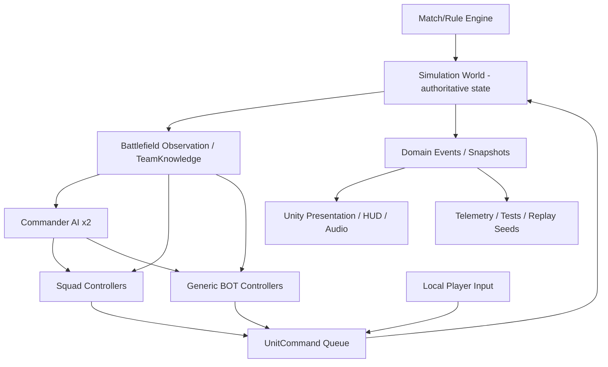

# システム設計書（Technical Design）v0.2

**対象:** Unity 6.3 LTS / C# / URP / Windows x64  
**最優先:** 100機同時稼働、ゲームルールの一貫性、AIによる機能単位開発・自動検証  
**位置付け:** 実装前の推奨設計。要件に優先する技術選定ではない。

## 1. 設計上の最優先原則
1. 戦闘ルールを**GameObject、描画、入力機器から分離**する。
2. Human/BOT/RemoteHumanが出すものは同じ `UnitCommand`。シミュレーションは入力の出所を知らない。
3. **WorldTruth（真の状態）**と**TeamKnowledge（各軍が把握した状態）**を分離。AIは後者から判断する。
4. 各軍は50の**ControllerSlot**と1つの**CommanderSlot**。操縦機体はデッキからスポーンし、全員同じCT・回復・ゲージ計算を通る。
5. 戦況への影響がある処理は、視界外でも継続する。描画・演出のみLOD。
6. まず通常のC#・GameObjectとデータ配列で実装し、Profileで明らかになった箇所だけBurst/Jobs/ECSへ移行する。
7. Windowsだけを初期ターゲットとするが、将来のオンライン用に`SimulationRunner`と`Transport`の境界を予約。
8. Unity Editorを手動操作しないでもシーン生成・テスト・ビルド・ベンチマーク実行ができること。

## 2. 実行アーキテクチャ


### 2.1 一方向依存
- `Contracts` ← `Simulation` ← `MatchRules`/`Battlefield`。
- `AI.Bot`, `AI.Squad`, `AI.Commander`は公開された読取APIを参照し、命令を生成するだけ。SimulationはAIへ依存しない。
- `UnityAdapters`は入力・GameObject・NavMesh・Animator・Particleを変換する層。Simulationから参照しない。
- オフラインではローカルの権威シミュレーション、オンラインでは将来のサーバー上で同じルール処理を実行する。ただし同期/予測/ロールバックは追加実装を要する。

## 3. 実装モジュール
| Assembly / 名前空間案 | 主な責務 | 絶対禁止依存 |
|---|---|---|
| `Game.Contracts` | IDs, Commands, Events, readonly interfaces | UnityEngine（可能な限り） |
| `Game.Simulation` | Unit/Weapon/Status/Projectile/Collision abstraction | AI, UI, Scene |
| `Game.Match` | Team gauge, respawn, deck CT, match state | Unity UI, AI |
| `Game.Battlefield` | capture, base ownership, spawn, team knowledge | Presentation |
| `Game.Navigation` | tactical routing and path intent | UI |
| `Game.AI.Bot` | FSM + utility decisions | Presentation |
| `Game.AI.Squad` | 4-unit tactical FSM and role assignment | Presentation |
| `Game.AI.Commander` | overall plans and front allocations | Presentation |
| `Game.UnityAdapters` | Physics/NavMesh bridge, input, prefab, renderer | concrete AI classes where avoidable |
| `Game.Tests` | EditMode/PlayMode/performance regression | production writes |

**注意:** 物理判定の完全純C#化は必須ではない。Unity PhysicsへのAdapterを許しつつ、ドメイン判断は独立する。Unityの物理は完全な決定論を保証しないため、再現テストは固定シード＋イベントログ＋許容差とする。

## 4. 最小データモデル
```text
MatchState
  MatchId, Tick, RemainingTime, Phase
  TeamState[2]: BattleGauge, MainBaseStates[2+], CommanderSlot
  ControllerSlot[100]: TeamId, ControllerType, Deck, ActiveUnitId?, RespawnState
  UnitState[n]: UnitId, OwnerSlotId, TeamId, UnitDefinitionId,
                 Position, Rotation, HP, Shield, Ammo, Boost, Status, LockTarget?
  UnitDeck[100]: DeckEntry[4?], CooldownUntilTick per entry
  MainBaseState[]: BaseId, TeamId, Health?, IsAttackable, WorldPosition, GaugeDamagePolicy
  CapturePointState[]: OwnerTeam?, Progress, PresenceCounts, SpawnEnabled
  SupplyState[]: Provider, Capabilities, Charge/Duration, Position
  StrategicWeaponState[]: Carrier, Armed, Fuse, BlastRadius, FriendlyFire
  TeamKnowledge[2]: LastKnownEnemy, Confidence, ThreatMap, RevealedAreas
```

### ID とレイヤーの扱い
- `ControllerSlotId`: 人間/BOTの参加枠。試合中、機体が撃破されても消えない。
- `UnitId`: 実際に出撃中の機体インスタンス。撃破/再出撃で更新。
- `DeckEntryId`: その参加枠が保有する機体候補。CTはここに紐づける。
- `CommanderSlot`: 両軍独立。操縦スロットを消費しない。
- `PlayerFlag`は入力元の識別に用いる。対人赤ロック補正などをここから判断する。機体戦闘処理そのものに特別な分岐を増やし過ぎない。

## 5. Command / Tick / Event契約
```csharp
public readonly struct UnitCommand
{
    public readonly int UnitId;
    public readonly float MoveX, MoveY;
    public readonly float AimYaw, AimPitch;
    public readonly bool Boost, FirePrimary, FireSecondary, Melee, UseAbility;
    public readonly uint Sequence;
}

public interface IUnitCommandSource
{
    bool TryGetCommand(int slotId, long tick, out UnitCommand command);
}

public interface ISimulationRunner
{
    void Submit(UnitCommand command);
    void Tick(float fixedDeltaTime);
    IReadOnlyList<GameEvent> DrainEvents();
}
```
**これは概念上のインターフェース例**であり、完全なビルド可能実装ではない。高頻度処理では構造体・配列・事前割当メモリ・イベントバッファを利用。ネットワーク化した際には権威サーバーでコマンドの妥当性確認が必要。

### 時間更新の初期案（要プロファイル）
| 処理 | 仮の更新頻度 | 方法 |
|---|---:|---|
| シミュレーション/当たり判定 | 50Hz | Fixed tick；高速移動にはsweep/raycast |
| ローカル描画 | 60fps目標 | render interpolation |
| 近距離BOT戦闘判断 | 2–5Hz | 時間スロットを分散 |
| 知覚/索敵更新 | 5–10Hz | 興味領域別に分散 |
| 小隊戦術 | 1–2Hz | イベント受信で臨時更新可能 |
| 指揮官作戦 | 0.5–1Hz | 作戦ヒステリシスで頻繁な切替抑制 |
| 戦況集計 | 2–5Hz | captureは固定Tickで正確に処理 |

## 6. 本拠点・ゲージ・中継拠点占領
### マップ本拠点定義（必須制約）
- `MapDefinition.MainBasesByTeam[0/1]` には**それぞれ最低2ヶ所**を定義する。標準試作マップは**3ヶ所/軍**とし、固定値にしない。
- ロード/ビルド前バリデーションで `count >= 2`、チーム、BaseId一意性、出撃可能領域、敵側から攻撃可能な経路、攻撃当たり判定の整合性を検査する。1ヶ所のみのマップは読み込み失敗（要修正）とする。
- `MainBaseState`は戦力ゲージ削減に結びつく攻撃対象であり、`CapturePointState`（中継地点）と型・目的・UI表示を分ける。
- 各本拠点には少なくとも一つの主要進入経路を用意し、標準マップでは正面・側面・迂回を組み合わせ、すべての本拠点が同一の必須狭路に依存しない構造とする。
- 指揮官/小隊AIは本拠点ごとの脅威・味方防衛数・最後に観測した敵・潜入経路を評価し、防衛配置と攻撃対象を**可変**にする。未観測の敵を知って防衛を自動発動してはいけない。
- 1ヶ所の本拠点を落としたときの扱い（恒久破壊、局所無効化、繰返し攻撃可能）は[TBD]。どの方式でも全本拠点はゲージ損害への寄与が可能な設計とする。

### 基本ルール
- `CombatEvent: UnitDestroyed` → 指定コストに対応するゲージ損害。
- `CombatEvent: BaseDamaged` → 攻撃が成立した場合のゲージ損害。主な勝利手段。
- `CapturePresence`では**有効な生存機の人数差**を数え、`CaptureProgress`を更新。
- 占領が完了すれば `SpawnAnchor`の所有状態を変更。
- 「所有中」「中立化中」「中立」「占領中」などの状態と占領進行方向を定義。

```text
netCount = validAllies - validEnemies
if netCount != 0:
    rate = CaptureRate(min(abs(netCount), PresenceCap))
    progress += sign(netCount) * rate * fixedDelta
else:
    progress remains unchanged  // prototype default
progress clamped to signed range [-1, +1]
owner changes only at configured state transition thresholds
```
**注意:** 上式は概念例。味方/敵どちらに正負を割り当てるか、途中の中立化、連続占領の閾値、リスポーン無効化タイミングなどは`CaptureRuleConfig`で管理。

## 7. 帰投・補給・CT
### Unit lifecycle
`AvailableDeckEntry → Spawned → Destroyed → Cooldown → Available`。帰投は`Spawned → Returning → SafeBase/Repair → Redeploy`の経路とし、撃破とは区別。

### Recovery provider
- `HomeRepairPod`: 帰投が必要。最高速のHP/Shield/Ammo回復。
- `SupportUnit`: 支援機による回復・補充。装備・対象種別の適合が必須。
- `DeployableRepairPod`: 範囲内複数機を回復。利用者の密集が発生する。
- `SupplyCompatibility`: 回復対象HP/Shield/Ammo、武装/弾種タグ、範囲、速度、資源、利用可能陣営。

### CT / 金功績
- `DeckEntry`ごとに`nextAvailableTick`を保持。BOTも全機体で同じ仕組みを使用。
- `GoldMeritAwarded`イベントでCT短縮ポリシーを実行。
- 連続補給・同一対象連打などで無限短縮ができないよう、`SourceId`,`Reason`,`Window`,`Cap`を確認。
- 全デッキ機がCT中なら再出撃待機。ゲーム外から無制限に機体を補充しない。

## 8. 赤ロック・格闘・自動カウンター禁止
```text
redLockRange = weapon.baseRedLockRange
if attacker.controllerType == BOT && target.controllerType == HUMAN:
    redLockRange *= botToHumanRedLockMultiplier  // prototype default 0.80
```
- `BOT→BOT` / `HUMAN→BOT` / `HUMAN→HUMAN`は基準距離。
- ロック外でも通常射撃可能。倍率は変更可能かつオンライン方針は分離。
- **自動カウンター禁止:** 被格闘を契機に入力なしで反撃/防御/無敵化/格闘割込みを起動するシステムは作らない。
- 手動回避、プレイヤーによるタイミング合わせた格闘迎撃、能動的なガードは別途設計可能。

## 9. 戦略核
- 一定範囲に対する爆発イベントとして扱い、敵味方のUnitDamage/ShieldDamageを通す。
- 核で中継拠点の所有権を直接更新しない。生存機数が変わることで通常の占領処理へ反映。
- タイミング、運搬、警告、爆発半径、友軍被害倍率はコンフィグ。
- 指揮官AI/小隊AIは味方被害を推定するが、不完全情報からの判断を許容する。

## 10. AIの3層構造
### 10.1 General Bot
- `Perception → Context/Utility → FSM State → UnitCommand`。
- 状態例: FrontlineHold, Pressure, Cover, Engage, Retreat, Repair, Capture, Defend, Flank, Return, WaitForCooldown。
- 性能劣化しない範囲で意図的に反応遅延と誤判断を許容。完全なチートエイムは禁止。

### 10.2 Squad AI (4機)
- 独立`SquadController`が共通目標、経路、役割、作戦中止基準を持つ。
- 小隊状態: Assemble, Travel, Recon, Execute, Retreat, Refit, Defend。
- 作戦プリセット: RushBase, Diversion, FocusFire, StrategicWeaponEscort, ForwardSupport, InterceptRaid, Ambush。
- 個体のデッキ/CTと機体復帰を把握し、4機揃わない場合は再編/代替戦術/中止を選択。

### 10.3 Commander AI
- 各軍の`TeamKnowledge`だけを読み、前線、ゲージ、**複数本拠点ごとの防衛状況**、中継拠点、敵の最後の観測位置、機体損失状況を評価。
- 指揮命令はBOT枠にのみ作用。人間への指示はHUD情報として送信し、ペナルティを付けない。
- 行動例: HoldFront, AttackRelay, BaseRushCountdown, GuardBase, StrategicWeaponPlan, AllocateSquads, Retreat/Regroup。
- 同時凸のためのカウントダウン/目的座標/戦術ピンを生成。

### 10.4 TeamKnowledge（非全知）
- `WorldTruth`への生データアクセスをAIの意思決定層に与えない。
- 知識更新源: 視界、レーダー、被弾方向、BOTの報告、拠点攻撃イベント（検出可能範囲に制限）。
- 目撃から時間が経つと鮮度を減衰させる。
- 情報非対称性から、防衛の穴・ネズミの成立が生まれる。

## 11. ナビゲーション
- `StrategicGraph`: マップが持つ北/中央/南等の主要ルートと危険度。
- `NavMesh/Path`: 選択ルート上の局所移動経路。
- `LocalSteering`: 味方との衝突軽減、遮蔽物、射線確保。
- ブースト/空中高速移動/多段格闘は専用の`MovementMotor`で処理し、NavMeshAgentの速度移動へ全て任せない。
- 4機小隊は戦術経路を共有、個体はローカル回避のみ個別計算。

## 12. 性能設計
### 基準機（達成目標・未測定）
- 2019年ミドル: Core i5-9400F / GTX 1660 6GB / RAM16GB / SSD程度。
- Windows x64 1920×1080、標準品質、**生存100機＋両軍指揮官動作時に平均60fps以上**を目指す。
- 負荷テストで1% Lowも報告（合格閾値は実機で規定）。

### 最初に実装する計測
- CPU main/thread、GPU、GC alloc/frame、draw calls、triangle counts、active units、projectiles、perception/squad/commander ms、NavMesh recalcs、frame histogram。
- Bench A: 100機通常戦。Bench B: 中央50機密集。Bench C: 全軍凸＋爆発多数。Bench D: 前線・別戦線＋**複数本拠点への同時奇襲/防衛分散**。Bench E: 全軍CT/再出撃回転。
- 実機ビルドで10分以上走らせ、平均/1% Low/異常フリーズ・GCピークを報告。

### 最適化の優先順
1. AI更新間引き・分散、経路共有、不要なアロケーション防止。
2. 機体/武器/爆発のpool、GPU instancing、LODとAnimator間引き。
3. 命中・範囲判定のbroad phase、必要な連続衝突判定。
4. Profilerで明確にボトルネックがある処理のみJobs/Burst化。
5. ECS/DOTSは規模と必要性が立証された場合にのみ検討。

## 13. 将来ネットワーク化の予約領域
- `ICommandTransport`, `ISnapshotTransport`, `IAuthorityPolicy`のインターフェースのみ初期確保。
- ローカル版はプロセス内で即時コマンド適用。将来のサーバー版は権威Tick、位置・弾・状態同期、入力検証、interpolation/prediction、interest management、reconnectを追加。
- **ネットワーク化はBOTスロットをHUMANに変更するだけでは完成しない。**
- 大規模対戦向けNetcode for Entities等は別技術検証で選定。初期段階で全面ECSは固定しない。
- オフライン2019年PCの要件と102人オンライン専用サーバー性能要件は分ける。

## 14. プロジェクト構造案
```text
Assets/Game/
  Runtime/
    Contracts/  Simulation/  Match/  Battlefield/  Navigation/
    AI/Bots/  AI/Squads/  AI/Commander/
    UnityAdapters/  Input/  Presentation/
  Editor/Generators/  Editor/BuildTools/
  Content/Units/  Content/Weapons/  Content/Maps/  Content/AIProfiles/
  Prefabs/  Scenes/
  Tests/EditMode/  Tests/PlayMode/  Tests/Performance/
AGENTS.md
README.md
GAME_SPEC.md  SYSTEM_DESIGN.md  GAME_VISION.md
scripts/test.ps1  scripts/build.ps1  scripts/benchmark.ps1
config/prototype-defaults.json
```
Assembly Definitionにより境界を管理する。YAML（Scene/Prefab）手編集よりEditor生成スクリプトを優先し、変更はGitで追跡。

## 15. テスト仕様
| テストID | 確認項目 | 自動合格条件 |
|---|---|---|
| T-001 | Slot算定 | 各軍50操縦枠＋指揮官1枠、空きはBOT補完 |
| T-002 | CT | BOT/HUMAN全員に同一のデッキ制約、CT中は選択不可 |
| T-003 | Capture | 人数差の符号で進行方向が変わり、拠点所有時のみ出撃先解放 |
| T-004 | Gauge | 撃破コストと本拠点ダメージが規定のゲージ損害に反映 |
| T-005 | Support | HP/Shield/Ammoを種別・容量・距離制約付きで回復 |
| T-006 | Return | 帰投完了で最高速補給へアクセスできる |
| T-007 | Nuclear | 敵味方を傷つける。直接の占領上書きを行わない |
| T-008 | Lock | BOT→HUMANのみ赤ロック距離補正が適用 |
| T-009 | Counter | 自動反撃イベント/状態が存在しない |
| T-010 | AI Knowledge | 未観測の敵位置が指揮AI判断に流れない |
| T-011 | Player Freedom | 指揮官作戦への不参加で制裁なし・強制操作なし |
| T-012 | Full bot game | 無操作で勝敗を決着、無限デッドロックを検出 |
| T-013 | Performance | 100機通常戦・密集戦のWindowsビルド実測ログ出力 |
| T-014 | Resource invariants | 常時有効枠<=100、CT無視出撃/無限弾薬/負のHPなし |
| T-015 | MainBase minimum | 各軍0〜1本拠点のマップを拒否し、各軍2ヶ所以上を有効と判定 |
| T-016 | Multi-base attack | 全本拠点が別IDで損害処理され、いずれへの攻撃も適切に敵ゲージへ反映 |
| T-017 | Raid/defense allocation | 3本拠点型試験マップで、陽動による防衛分散・別拠点へのネズミが成立し、指揮官は未観測敵を透視しない |

## 16. 段階開発・各フェーズの受け入れ条件
- **P0 技術基盤**: 100枠/2指揮官/**各軍3本拠点の標準試験マップ**/軽量機体/計測・ビルド・テストの完全自動実行。各軍2本拠点未満の入力拒否もテスト。
- **P1 戦闘コア**: 移動/射撃/格闘/ブースト/HP/Shield/Ammo/CT/赤ロック、Player/BOT共通操作。
- **P2 大規模戦成立**: **複数本拠点への攻防**、中継占領、補給、戦力ゲージ、帰投・リスポーン、一般BOTの自動試合完走。
- **P3 小隊**: 4機で連携し、ネズミ・前線支援・防衛帰投・戦略核護衛を行える。
- **P4 指揮官**: 戦況認識に基づく作戦・一斉凸・陽動、防衛の穴が動的に生じる。
- **P5 製品品質**: マップ/アート/UI/音響/調整、2019年基準PC実機で性能受入。
- **P6 将来拡張**: ネットワークP0C → 人間/BOT混成 → 102人上限負荷試験 → 指揮官プレイ。

**成果物完成の定義:** コードが存在することではなく、ゲームの実行結果＋自動テスト＋実測レポート＋人間の体験評価が揃ったこと。

## 17. AIエージェントが作業を始める順序
1. 仕様書・設計書・ビジョンを読み、要件IDごとのテストケース一覧を生成。
2. ContractsとP0の軽量Worldを設計し、CPU/Render計測を組み込む。
3. テスト用シーンをEditor Generatorから生成。
4. バッチモードでコンパイル/EditMode/PlayModeテストを実行。
5. Windows standaloneを起動し100機Bench A–Eを計測。
6. 結果に基づきP1へ進む。P0が未達なら機能追加せず原因を解析。

## 18. 技術参照
- Unity 6 LTS: https://unity.com/releases/unity-6/support
- Command line: https://docs.unity.cn/6000.3/Documentation/Manual/EditorCommandLineArguments.html
- Unity Netcode: https://docs.unity.com/multiplayer/netcode/netcode
- Unity Test Framework: https://docs.unity.cn/Packages/com.unity.test-framework%401.3/manual/reference-command-line.html
